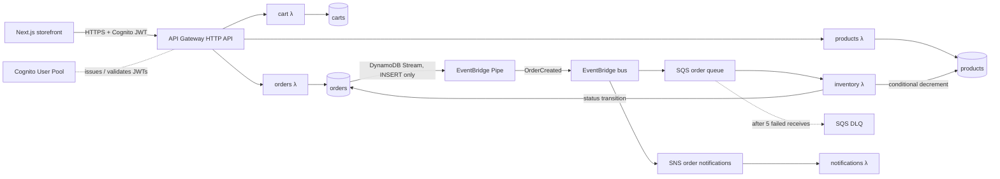

# CloudCart

A serverless, event-driven e-commerce backend on AWS. Every resource is defined in Terraform and shipped through GitHub Actions. The backend and infrastructure are the core of the project; the Next.js storefront is a thin demo client.

## Status

| Area | State |
| --- | --- |
| Products, Cart and Orders APIs (HTTP API + Lambda + DynamoDB) | Done |
| Cognito sign-up/sign-in and JWT authorization on protected routes | Done |
| Async order processing (DynamoDB Streams → EventBridge Pipe → SQS/SNS) | Done |
| Observability (CloudWatch alarms, dashboard, saved Logs Insights queries, X-Ray) | Done |
| Least-privilege IAM review and CI permissions boundary | Done |
| Unit tests (57 Jest tests, coverage floor enforced in CI) | Done |
| Integration test suite against the deployed API | Done |
| CI on pull requests, deploy to dev on merge to `main` | Done |
| Shared `app` module wiring each environment | Done |
| **prod environment** and the approval-gated prod stages of the deploy pipeline | **In progress** |
| Frontend wired to the real API and Cognito | Not started (it uses local mock data today) |

## Architecture



**Request path.** API Gateway's built-in JWT authorizer validates Cognito tokens, so there is no custom authorizer Lambda. Handlers take the user ID from the token's `sub` claim and never from the request body.

**Order path.** The orders Lambda writes the order and nothing else. A DynamoDB Stream on the orders table feeds an EventBridge Pipe, which publishes `OrderCreated` to a custom bus. Two rules fan that event out: one to SQS for the inventory Lambda, one to SNS for the notifications Lambda.

### Key design decisions

- **No dual write.** If the orders Lambda wrote to DynamoDB and then called `PutEvents`, a crash between the two calls would leave an order with no event. Emitting events from the table's stream ties the event to the committed write, and the orders Lambda has no EventBridge permission at all.
- **Idempotent consumer without an idempotency table.** SQS and Pipes both deliver at least once. The inventory Lambda decrements stock with `ConditionExpression: inventory >= :qty`, which also prevents overselling, and moves order status only from the expected prior state. A redelivered message fails the condition and is treated as already processed.
- **Transactional checkout.** `POST /orders` uses `TransactWriteItems` to create the order and clear the cart together. A condition on the cart's `updatedAt` rejects a checkout against a cart that changed mid-request. Cart writes use the same optimistic-concurrency check.
- **Partial batch failures.** The inventory Lambda reports failed message IDs individually, so one bad message is retried without re-running the rest of the batch.
- **Separate directories per environment, not workspaces.** Each environment is its own root module and state file, so applying to the wrong one takes an explicit `cd`. Both call the same `modules/app`, and they differ only in a handful of arguments.

## Tech stack

| Layer | Choice |
| --- | --- |
| Compute | AWS Lambda, Node.js 24, ARM64 (Graviton), bundled with esbuild |
| API | API Gateway HTTP API (v2), native JWT authorizer |
| Auth | Amazon Cognito User Pool + public app client |
| Data | DynamoDB on-demand: `products`, `carts`, `orders` + `userId-createdAt-index` GSI |
| Events | DynamoDB Streams, EventBridge Pipes, EventBridge custom bus, SQS + DLQ, SNS |
| Observability | CloudWatch Logs (structured JSON), alarms, dashboard, Logs Insights queries, X-Ray |
| IaC | Terraform 1.14, AWS provider 6.x, S3 remote state with DynamoDB locking, tflint |
| CI/CD | GitHub Actions, GitHub OIDC → IAM role (no stored AWS keys) |
| Tests | Jest, ts-jest, aws-sdk-client-mock |
| Frontend | Next.js 16, React 19, Tailwind CSS 4 |

## API

| Method | Route | Auth | Lambda |
| --- | --- | --- | --- |
| GET | `/products` | public | products |
| GET | `/products/{id}` | public | products |
| GET | `/cart` | JWT | cart |
| POST | `/cart/items` — `{ productId, quantity }` | JWT | cart |
| DELETE | `/cart/items/{productId}` | JWT | cart |
| POST | `/orders` — checks out the caller's cart | JWT | orders |
| GET | `/orders` — caller's orders, newest first | JWT | orders |
| GET | `/orders/{id}` | JWT | orders |

New orders return `status: "PENDING"`. They move to `COMPLETE`, or to `FAILED` when stock runs out, once the inventory Lambda processes the event.

Errors share one shape:

```json
{ "error": { "code": "PRODUCT_NOT_FOUND", "message": "Product prod_999 does not exist" } }
```

## Repository layout

```text
backend/
  functions/<name>/handler.ts   # products, cart, orders, inventory, notifications (+ handler.test.ts)
  shared/                       # auth, DynamoDB client, logger, request parsing, responses
  integration/                  # golden-path suite against a deployed environment
infrastructure/
  bootstrap/                    # one-time: state bucket, lock table, GitHub OIDC provider, deploy role, boundary
  modules/
    app/                        # wires every module below into one environment
    api-gateway/ cognito/ dynamodb/ lambda/ order-events/ sqs/ sns/ monitoring/
  environments/
    dev/                        # root module + state for dev
    prod/                       # root module + state for prod (in progress)
frontend/                       # Next.js demo storefront (mock data layer today)
.github/
  workflows/test.yml            # PR checks, also reused by deploy.yml
  workflows/deploy.yml          # main → dev → smoke test → prod plan → approval → prod
  actions/terraform/            # composite action: build bundles, assume role, plan/apply
```

## Getting started

Prerequisites: an AWS account, AWS CLI v2 configured for `us-east-1`, Terraform 1.14+, and Node.js 24.

### 1. Bootstrap (once per AWS account)

Terraform can't create the backend it stores its own state in, so this root module is applied by hand, once. It uses local state.

```bash
cd infrastructure/bootstrap
terraform init
terraform apply
```

It creates the state bucket and lock table, the GitHub OIDC provider, the `cloudcart-github-actions` deploy role, and the permissions boundary every app role must carry. Then:

- Put `state_bucket_name` and `lock_table_name` into each `environments/*/backend.tf`.
- Set `github_actions_role_arn` as the `AWS_ROLE_ARN` repository variable in GitHub.
- If you fork the repo, change `github_repository` in `bootstrap/variables.tf` first. The trust policy matches GitHub's immutable subject (`owner@id/repo@id`), not the repo name.

### 2. Deploy dev from your machine

```bash
cd backend
npm ci
npm run build

cd ../infrastructure/environments/dev
echo 'alarm_email = "you@example.com"' > local.auto.tfvars
terraform init
terraform apply
```

`local.auto.tfvars` is gitignored. Confirm the SNS subscription email to receive alarms. `terraform output api_endpoint` prints the API URL, and products are seeded by Terraform.

### 3. Run the tests

```bash
cd backend
npm test
npm run test:coverage
```

The integration suite runs the full golden path against a deployed environment: sign in, list products, add to cart, check out, poll until the order completes, then check that stock went down. It needs a confirmed Cognito test user.

```bash
cd backend
export CLOUDCART_API_URL=$(terraform -chdir=../infrastructure/environments/dev output -raw api_endpoint)
export CLOUDCART_COGNITO_CLIENT_ID=$(terraform -chdir=../infrastructure/environments/dev output -raw cognito_client_id)
export CLOUDCART_TEST_USERNAME=you@example.com
export CLOUDCART_TEST_PASSWORD='your-test-password'
npm run test:integration
```

### 4. Run the storefront

```bash
cd frontend
npm ci
npm run dev
```

Open http://localhost:3000. The storefront currently uses a local mock data layer (`frontend/lib/api.ts`) and mock auth, so it runs without the backend.

## CI/CD

**`test.yml`** runs on every pull request with read-only permissions and no AWS credentials:

- Backend: `tsc --noEmit`, Jest with coverage, then an esbuild build of every Lambda
- Frontend: ESLint
- Terraform: `fmt -check`, `tflint --recursive`, and `validate` for `bootstrap`, `dev` and `prod`

**`deploy.yml`** runs on push to `main`:

1. Reruns `test.yml`, so `main` can't deploy anything a PR wouldn't pass.
2. **Deploy dev:** builds the bundles, assumes the deploy role through OIDC, then plans and applies the saved plan.
3. **Smoke test dev:** runs the integration suite against the API that was just deployed.
4. **Plan prod:** plans without applying, so the reviewer can read it first.
5. **Deploy prod:** waits for a required reviewer on the `prod` GitHub Environment, then re-plans and applies.
6. **Smoke test prod:** `GET /products` must return 200 and an anonymous `GET /cart` must return 401.

Deploys queue rather than cancel, because interrupting `terraform apply` can leave state locked.

**Required GitHub settings:** the `AWS_ROLE_ARN` and `CLOUDCART_TEST_USERNAME` variables, the `ALARM_EMAIL` secret, and `dev` and `prod` environments. Put `CLOUDCART_TEST_PASSWORD` on `dev`, and add a required reviewer on `prod`.

## Security

- **No static AWS credentials.** GitHub Actions gets short-lived credentials through OIDC. The deploy role trusts only `main`-branch jobs and the `dev`/`prod` environment jobs, so pull requests never receive AWS credentials.
- **No privilege escalation from CI.** The deploy role can create IAM roles only if they carry the `cloudcart-workload-boundary` permissions boundary. It also can't detach or edit that boundary.
- **Least-privilege Lambda roles.** Each function gets only the DynamoDB actions it uses, on its own tables, and log permissions on its own log group. For example, the orders role has no EventBridge access, and the cart role can only read `products`.
- **Identity from the token.** Cart and order operations take the user ID from the verified JWT, never from the request.
- **Pinned Actions.** Third-party Actions are pinned to commit SHAs, and checkout doesn't persist credentials.

## Monitoring

Alarms publish to a `cloudcart-<env>-ops-alerts` SNS topic, which is separate from the customer-facing order notifications.

| Alarm | Why it exists |
| --- | --- |
| Lambda `Errors` > 0 (per function) | Any unhandled exception |
| Lambda `Throttles` > 0 (per function) | Concurrency limit reached; requests are being dropped |
| API `5xx` > 0 | Server-side failures callers can see |
| API 4xx rate | Rising client errors, measured as a rate so a few 401s on a quiet API don't page anyone |
| API p99 latency | The slowest 1% of requests are degrading |
| Order queue backlog / oldest message age | Inventory processing is falling behind |
| DLQ messages > 0 | An order failed 5 times and won't finish on its own |
| Pipe `ExecutionFailed` | Orders are being written but their events aren't being published |
| Rule `FailedInvocations` | EventBridge couldn't deliver to SQS or SNS |

A CloudWatch dashboard (`terraform output dashboard_url`) charts these metrics plus DynamoDB consumed capacity. There are four saved Logs Insights queries: `errors`, `order-timeline`, `inventory-outcomes` and `lambda-performance`. Every Lambda writes structured JSON logs with `requestId`, `userId` and `orderId`/`productId`. X-Ray active tracing is on for every Lambda, and the DynamoDB client is instrumented so each table call appears as its own subsegment.

## Cost

Nothing in the design bills while it sits idle:

- DynamoDB on-demand capacity: no provisioned throughput to pay for at demo traffic.
- ARM64 Lambdas: about 20% cheaper per GB-second than x86.
- HTTP API instead of REST API: about 70% cheaper per request, with a free native JWT authorizer.
- No VPC, so no NAT gateway. Every service is reached through its public AWS endpoint.
- No provisioned concurrency, caching layer or custom domain.

## Out of scope

The design deliberately leaves out payments, multi-region deployment and DR, WAF and custom throttling, a caching layer, and hosting the frontend on AWS.
