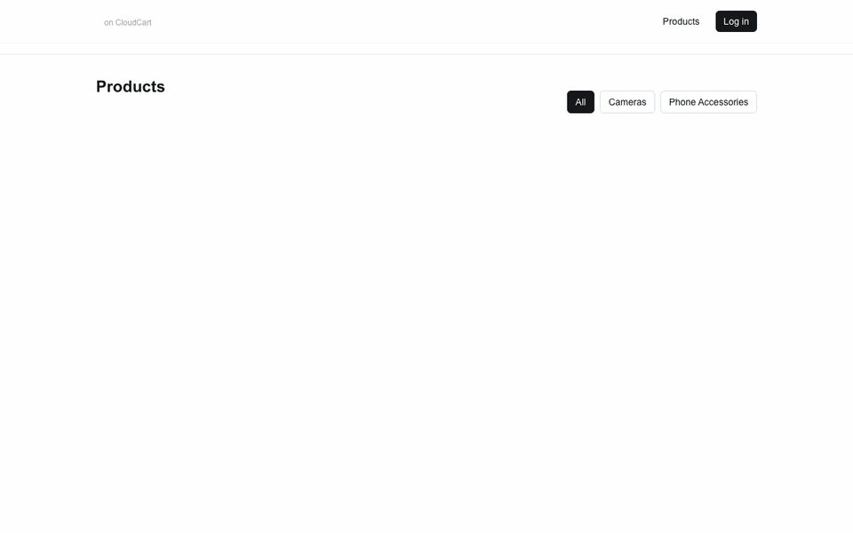
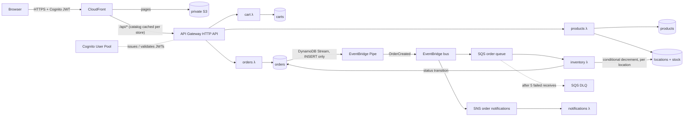
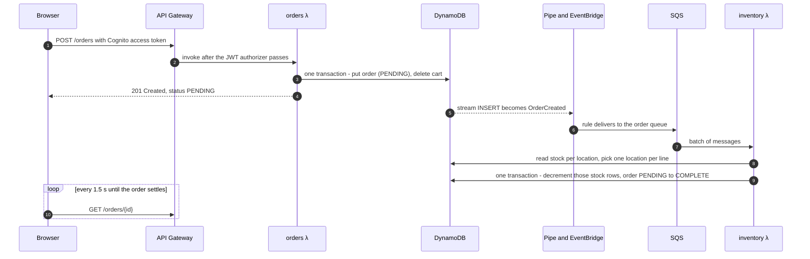
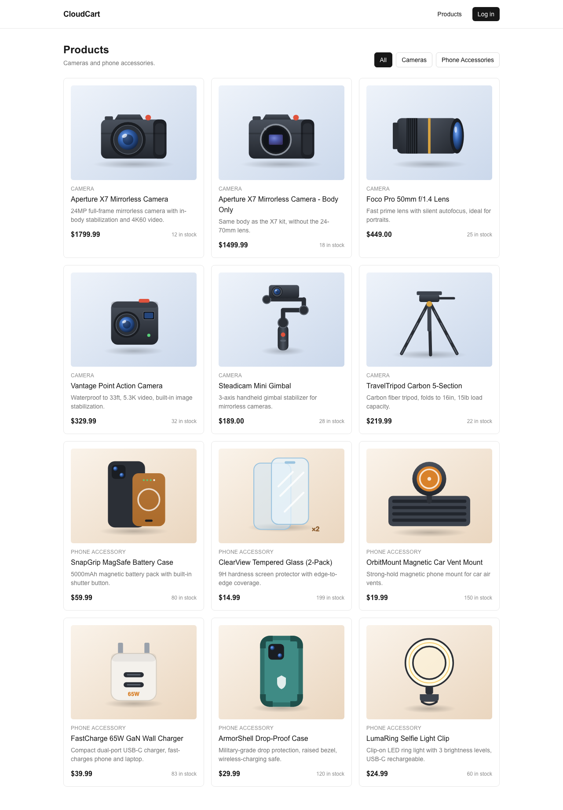
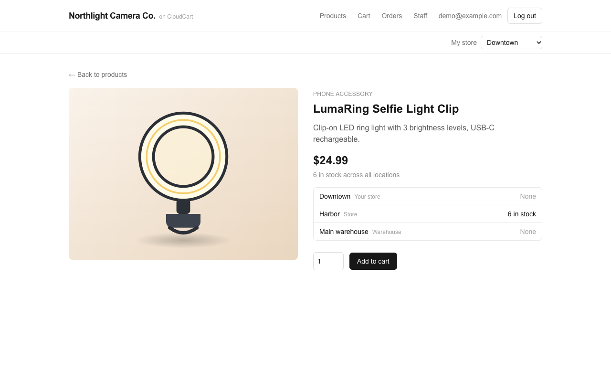
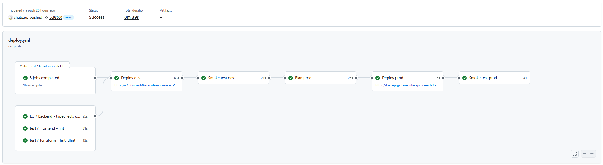
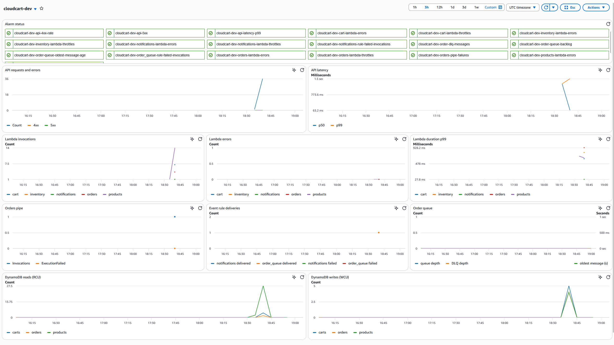
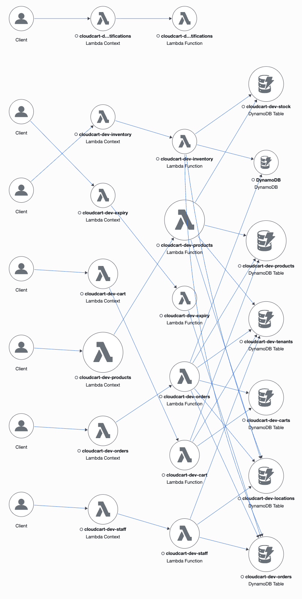

# CloudCart

A serverless, event-driven e-commerce backend on AWS. Every resource is defined in Terraform and shipped through GitHub Actions. The backend and infrastructure are the core of the project; the Next.js storefront is a thin demo client.



*A real session against the dev environment, recorded by [`frontend/scripts/record-demo.mjs`](frontend/scripts/record-demo.mjs). The order shows `PENDING` and turns `COMPLETE` a few seconds later, once the inventory Lambda has reserved stock through the async [order path](#architecture). [Full-resolution MP4](docs/demo/cloudcart-demo.mp4).*

## Status

| Area | State |
| --- | --- |
| Products, Cart and Orders APIs (HTTP API + Lambda + DynamoDB) | Done |
| Cognito sign-up/sign-in and JWT authorization on protected routes | Done |
| Async order processing (DynamoDB Streams → EventBridge Pipe → SQS/SNS) | Done |
| Observability (CloudWatch alarms, dashboard, saved Logs Insights queries, X-Ray) | Done |
| Least-privilege IAM review and CI permissions boundary | Done |
| Unit tests (77 Jest tests, coverage floor enforced in CI) | Done |
| Integration test suite against the deployed API | Done |
| CI on pull requests, deploy to dev on merge to `main` | Done |
| Shared `app` module wiring each environment | Done |
| prod environment and the approval-gated prod stages of the deploy pipeline | Done |
| Frontend wired to the real API and Cognito, with a seeded 12-product catalog | Done |
| Static storefront on S3 + CloudFront, deployed by the pipeline | Done |
| Multi-tenancy: every table partitioned by tenant, two seeded stores | Done |
| API served through CloudFront at `/api`, catalog cached per store at the edge; AWS Budgets alert | Done |
| Endless aisle: stores and a warehouse per business, stock per location, warehouse-first allocation | Done |

## Architecture



**Request path.** One CloudFront distribution serves both the storefront and its API: pages come from S3, and `/api/*` goes to the HTTP API with the `/api` prefix stripped by a CloudFront Function. The site and API share an origin, so the hosted storefront needs no CORS. API Gateway's built-in JWT authorizer validates Cognito tokens, so there is no custom authorizer Lambda. Handlers take the user ID from the token's `sub` claim and never from the request body.

**Order path.** The orders Lambda writes the order and nothing else. A DynamoDB Stream on the orders table feeds an EventBridge Pipe, which publishes `OrderCreated` to a custom bus. Two rules fan that event out: one to SQS for the inventory Lambda, one to SNS for the notifications Lambda.



The API answers checkout before stock is reserved, so a slow or failing inventory step never blocks the customer. If no location can fill a line, the inventory Lambda marks the order `FAILED` with a reason instead.

### Screenshots

| Product catalog (12 products, seeded by Terraform) | Product page |
| --- | --- |
|  |  |

### Behind the scenes

**Deploy pipeline.** A merge to `main` reruns the tests, deploys and smoke-tests dev, plans prod, waits for a reviewer, then deploys and smoke-tests prod (see [CI/CD](#cicd)).



**CloudCart dashboard in CloudWatch (dev), after the demo run.** Every alarm is OK, and the spike on the right is the recorded session (see [Monitoring](#monitoring)).



**X-Ray trace map.** Each Lambda and the DynamoDB tables it calls, drawn from the traces of the same session.



### Key design decisions

- **No dual write.** If the orders Lambda wrote to DynamoDB and then called `PutEvents`, a crash between the two calls would leave an order with no event. Emitting events from the table's stream ties the event to the committed write, and the orders Lambda has no EventBridge permission at all.
- **Idempotent consumer without an idempotency table.** SQS and Pipes both deliver at least once. The inventory Lambda decrements stock with `ConditionExpression: quantity >= :qty`, which also prevents overselling, and moves order status only from the expected prior state. A redelivered message fails the condition and is treated as already processed.
- **Transactional checkout.** `POST /orders` uses `TransactWriteItems` to create the order and clear the cart together. A condition on the cart's `updatedAt` rejects a checkout against a cart that changed mid-request. Cart writes use the same optimistic-concurrency check.
- **Partial batch failures.** The inventory Lambda reports failed message IDs individually, so one bad message is retried without re-running the rest of the batch.
- **Stock per location, for endless aisle.** Each business has stores and a warehouse (`locations`), and stock is one row per product per location (`stock`, keyed `<productId>#<locationId>`), not a count on the product. A shopper sees what's at their chosen store and what the business holds everywhere else, and can buy either. The inventory Lambda fills each order line from one location: the warehouse first, so store shelves stay stocked for walk-in customers, then a store. If another order takes the stock between the read and the write, the transaction's condition fails and the Lambda re-reads and re-allocates, up to three times. The order records where each line came from.
- **Pool multi-tenancy.** One deployment serves many businesses. Every table's partition key is `tenantId`, every request names its store with `X-Tenant-Id` (checked against a `tenants` table), and every DynamoDB key is built by one helper that takes the tenant first, so no handler can address another store's data by ID alone. A shopper's single Cognito account works at every store, with a separate cart and order history at each. Listing a catalog is a `Query` on the tenant's partition rather than a `Scan` of the table.
- **Catalog caching at the edge, not in a cache cluster.** `GET /tenant`, `/products` and `/products/{id}` are cached at CloudFront for 30 seconds, with `X-Tenant-Id` in the cache key so each store is cached separately; a test proves one store's cached catalog is never served to another. Catalog reads are public, read-heavy and fine to be seconds stale, so this replaces DAX or ElastiCache at no cost. Every other route is never cached and is keyed on `Authorization`, because CloudFront strips that header from GET requests unless it's in the cache key. Stock is still enforced at checkout by the conditional write, so a stale catalog can't oversell.
- **Separate directories per environment, not workspaces.** Each environment is its own root module and state file, so applying to the wrong one takes an explicit `cd`. Both call the same `modules/app`, and they differ only in a handful of arguments.

## Tech stack

| Layer | Choice |
| --- | --- |
| Compute | AWS Lambda, Node.js 24, ARM64 (Graviton), bundled with esbuild |
| API | API Gateway HTTP API (v2), native JWT authorizer, behind CloudFront |
| Auth | Amazon Cognito User Pool + public app client |
| Data | DynamoDB on-demand: `tenants`, `locations`, `products`, `stock`, `carts`, `orders` + `tenantUser-createdAt-index` GSI |
| Events | DynamoDB Streams, EventBridge Pipes, EventBridge custom bus, SQS + DLQ, SNS |
| Observability | CloudWatch Logs (structured JSON), alarms, dashboard, Logs Insights queries, X-Ray |
| IaC | Terraform 1.14, AWS provider 6.x, S3 remote state with DynamoDB locking, tflint |
| CI/CD | GitHub Actions, GitHub OIDC → IAM role (no stored AWS keys) |
| Tests | Jest, ts-jest, aws-sdk-client-mock |
| Frontend | Next.js 16, React 19, Tailwind CSS 4 |

## API

The hosted storefront calls the API at `<site_url>/api` (for example `/api/products`); the HTTP API's own endpoint serves the same routes at the root and is what local development uses. Every request names its store with an `X-Tenant-Id` header (for example `northlight`). A missing or malformed header returns 400 and an unknown store 404, before any store data is read.

| Method | Route | Auth | Lambda |
| --- | --- | --- | --- |
| GET | `/tenant` — the store's name and tagline | public | products |
| GET | `/locations` — the business's stores and warehouse | public | products |
| GET | `/products` — each with `stock: [{ locationId, quantity }]` | public | products |
| GET | `/products/{id}` — with its stock per location | public | products |
| GET | `/cart` | JWT | cart |
| POST | `/cart/items` — `{ productId, quantity }` | JWT | cart |
| DELETE | `/cart/items/{productId}` | JWT | cart |
| POST | `/orders` — checks out the caller's cart | JWT | orders |
| GET | `/orders` — caller's orders, newest first | JWT | orders |
| GET | `/orders/{id}` | JWT | orders |

New orders return `status: "PENDING"`. They move to `COMPLETE`, with each line's `sourceLocationId`, or to `FAILED` when no location can fill a line, once the inventory Lambda processes the event.

Errors share one shape:

```json
{ "error": { "code": "PRODUCT_NOT_FOUND", "message": "Product prod_999 does not exist" } }
```

## Repository layout

```text
backend/
  functions/<name>/handler.ts   # products, cart, orders, inventory, notifications (+ handler.test.ts)
  shared/                       # auth, DynamoDB client, logger, request parsing, responses
  integration/                  # golden-path suite against a deployed environment
infrastructure/
  bootstrap/                    # one-time: state bucket, lock table, GitHub OIDC provider, deploy role, boundary, budget
  modules/
    app/                        # wires every module below into one environment
    api-gateway/ cognito/ dynamodb/ lambda/ order-events/ sqs/ sns/ monitoring/ static-site/
  environments/
    dev/                        # root module + state for dev
    prod/                       # root module + state for prod
frontend/                       # Next.js storefront, a static export: real API + Cognito (SRP) sign-in
docs/demo/                      # demo MP4 and GIF, recorded by frontend/scripts/record-demo.mjs
docs/screenshots/               # images used in this README
.github/
  workflows/test.yml            # PR checks, also reused by deploy.yml
  workflows/deploy.yml          # main → dev → smoke test → prod plan → approval → prod
  actions/terraform/            # composite action: build bundles, assume role, plan/apply
  actions/frontend/             # composite action: build the static export, upload to S3, invalidate CloudFront
```

## Getting started

Prerequisites: an AWS account, AWS CLI v2 configured for `us-east-1`, Terraform 1.14+, and Node.js 24.

### 1. Bootstrap (once per AWS account)

Terraform can't create the backend it stores its own state in, so this root module is applied by hand, once. It uses local state.

```bash
cd infrastructure/bootstrap
echo 'alarm_email = "you@example.com"' > local.auto.tfvars   # where budget alerts go; gitignored
terraform init
terraform apply
```

It creates the state bucket and lock table, the GitHub OIDC provider, the `cloudcart-github-actions` deploy role, the permissions boundary every app role must carry, and a $10 monthly AWS Budgets alert. Then:

- Put `state_bucket_name` and `lock_table_name` into each `environments/*/backend.tf`.
- Set `github_actions_role_arn` as the `AWS_ROLE_ARN` repository variable in GitHub.
- If you fork the repo, change `github_repository` in `bootstrap/variables.tf` first. The trust policy matches GitHub's immutable subject (`owner@id/repo@id`), not the repo name.

### 2. Deploy dev from your machine

```bash
cd backend
npm ci
npm run build

cd ../infrastructure/environments/dev
echo 'alarm_email = "you@example.com"' > local.auto.tfvars
terraform init
terraform apply
```

`local.auto.tfvars` is gitignored. Confirm the SNS subscription email to receive alarms. `terraform output api_endpoint` prints the API URL, and products are seeded by Terraform.

### 3. Run the tests

```bash
cd backend
npm test
npm run test:coverage
```

The integration suite runs the full golden path against a deployed environment: sign in, list products, add to cart, check out, poll until the order completes, then check that the stock came from the warehouse and went down there. It also checks tenant isolation between the two seeded stores (`northlight` and `tidewater`): each has its own catalog where product IDs overlap, its own cart for the same shopper, and can't see the other's orders. With `CLOUDCART_SITE_URL` set (the `site_url` output), it also checks the CloudFront `/api` path: a repeat catalog request is a cache hit, each store is cached separately, signed-in requests carry their token and are never cached, and API errors arrive as JSON. It needs a confirmed Cognito test user.

```bash
cd backend
export CLOUDCART_API_URL=$(terraform -chdir=../infrastructure/environments/dev output -raw api_endpoint)
export CLOUDCART_COGNITO_CLIENT_ID=$(terraform -chdir=../infrastructure/environments/dev output -raw cognito_client_id)
export CLOUDCART_SITE_URL=$(terraform -chdir=../infrastructure/environments/dev output -raw site_url)
export CLOUDCART_TEST_USERNAME=you@example.com
export CLOUDCART_TEST_PASSWORD='your-test-password'
npm run test:integration
```

### 4. Run the storefront

```bash
cd frontend
npm ci
npm run env:dev   # writes .env.local from the dev Terraform outputs
npm run dev
```

Open http://localhost:3000 (the API's CORS setting allows only this origin; the hosted storefront needs no CORS because it calls `/api` on its own origin). Sign up with a real email address: Cognito emails a confirmation code, and sign-in then uses SRP, so the password never leaves the browser. See [`frontend/README.md`](frontend/README.md) for how the client maps to the API and how to re-record the demo.

## CI/CD

**`test.yml`** runs on every pull request with read-only permissions and no AWS credentials:

- Backend: `tsc --noEmit`, Jest with coverage, then an esbuild build of every Lambda
- Frontend: ESLint
- Terraform: `fmt -check`, `tflint --recursive`, and `validate` for `bootstrap`, `dev` and `prod`

```mermaid
flowchart LR
    pr[Pull request] --> checks[test.yml: 6 required checks]
    checks -->|rebase and merge| main[push to main]
    main --> rerun[test.yml again] --> dev[Deploy dev] --> smokedev[Smoke test dev]
    smokedev --> plan[Plan prod] --> gate{{Required reviewer approves}} --> prod[Deploy prod] --> smokeprod[Smoke test prod]
```



**`deploy.yml`** runs on push to `main`:

1. Reruns `test.yml`, so `main` can't deploy anything a PR wouldn't pass.
2. **Deploy dev:** builds the bundles, assumes the deploy role through OIDC, then plans and applies the saved plan. It then builds the storefront against `/api` and dev's Cognito, uploads it to S3 and invalidates CloudFront.
3. **Smoke test dev:** runs the integration suite against the API that was just deployed, both directly and through CloudFront's `/api` path, then checks that the storefront serves a page (200) and a missing page (404).
4. **Plan prod:** plans without applying, so the reviewer can read it first.
5. **Deploy prod:** waits for a required reviewer on the `prod` GitHub Environment, then re-plans, applies, and deploys the storefront the same way.
6. **Smoke test prod:** through the storefront's URL, `GET /api/products` must return 200, an anonymous `GET /api/cart` must return 401, and the `/products/` page must return 200.

Deploys queue rather than cancel, because interrupting `terraform apply` can leave state locked.

**Required GitHub settings:** the `AWS_ROLE_ARN` and `CLOUDCART_TEST_USERNAME` variables, the `ALARM_EMAIL` secret, and `dev` and `prod` environments. Put `CLOUDCART_TEST_PASSWORD` on `dev`, and add a required reviewer on `prod`.

## Security

- **No static AWS credentials.** GitHub Actions gets short-lived credentials through OIDC. The deploy role trusts only `main`-branch jobs and the `dev`/`prod` environment jobs, so pull requests never receive AWS credentials.
- **No privilege escalation from CI.** The deploy role can create IAM roles only if they carry the `cloudcart-workload-boundary` permissions boundary. It also can't detach or edit that boundary.
- **Least-privilege Lambda roles.** Each function gets only the DynamoDB actions it uses, on its own tables, and log permissions on its own log group. For example, the orders role has no EventBridge access, and the cart role can only read `products`.
- **Identity from the token.** Cart and order operations take the user ID from the verified JWT, never from the request.
- **Private storefront bucket.** The site bucket blocks all public access. CloudFront reads it through Origin Access Control, and the bucket policy admits only that one distribution. CloudFront adds standard security headers (HSTS, `nosniff`, frame and referrer policies) to pages and API responses, and AWS Shield Standard DDoS protection to both.
- **Cost alarm.** An account-wide AWS Budgets alert (in `bootstrap/`) emails at 80% of a $10 monthly limit and when the month is forecast to pass it. With no WAF, it's the backstop against a flood of valid requests that throttling alone wouldn't make free.
- **Pinned Actions.** Third-party Actions are pinned to commit SHAs, and checkout doesn't persist credentials.

## Monitoring

Alarms publish to a `cloudcart-<env>-ops-alerts` SNS topic, which is separate from the customer-facing order notifications.

| Alarm | Why it exists |
| --- | --- |
| Lambda `Errors` > 0 (per function) | Any unhandled exception |
| Lambda `Throttles` > 0 (per function) | Concurrency limit reached; requests are being dropped |
| API `5xx` > 0 | Server-side failures callers can see |
| API 4xx rate | Rising client errors, measured as a rate so a few 401s on a quiet API don't page anyone |
| API p99 latency | The slowest 1% of requests are degrading |
| Order queue backlog / oldest message age | Inventory processing is falling behind |
| DLQ messages > 0 | An order failed 5 times and won't finish on its own |
| Pipe `ExecutionFailed` | Orders are being written but their events aren't being published |
| Rule `FailedInvocations` | EventBridge couldn't deliver to SQS or SNS |

A CloudWatch dashboard (`terraform output dashboard_url`) charts these metrics plus DynamoDB consumed capacity. There are four saved Logs Insights queries: `errors`, `order-timeline`, `inventory-outcomes` and `lambda-performance`. Every Lambda writes one JSON object per log line with `requestId`, `traceId` and `coldStart`, plus `userId` and `orderId` where they're known, so one Logs Insights query can follow an order across three functions. X-Ray active tracing is on for every Lambda, and the DynamoDB client is instrumented so each table call appears as its own subsegment.

## Cost

Nothing in the design bills while it sits idle:

- DynamoDB on-demand capacity: no provisioned throughput to pay for at demo traffic.
- ARM64 Lambdas: about 20% cheaper per GB-second than x86.
- HTTP API instead of REST API: about 70% cheaper per request, with a free native JWT authorizer.
- No VPC, so no NAT gateway. Every service is reached through its public AWS endpoint.
- A static storefront on S3 + CloudFront instead of a server: CloudFront's always-free tier covers 1 TB and 10 million requests a month.
- Catalog caching at CloudFront instead of DAX or ElastiCache, which bill per node-hour even when idle. Cached catalog requests never reach API Gateway or Lambda.
- No provisioned concurrency or custom domain.

## Out of scope

The design deliberately leaves out payments, multi-region deployment and DR, WAF and custom throttling, and a custom domain (which would also let the API's default endpoint be closed, so all traffic passes through CloudFront).
